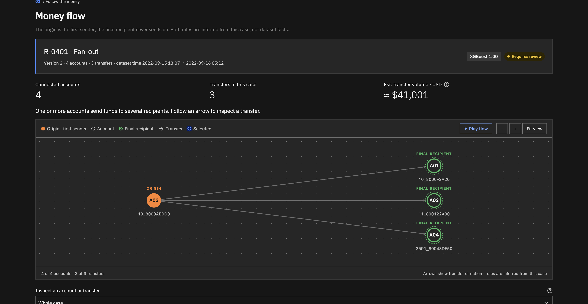
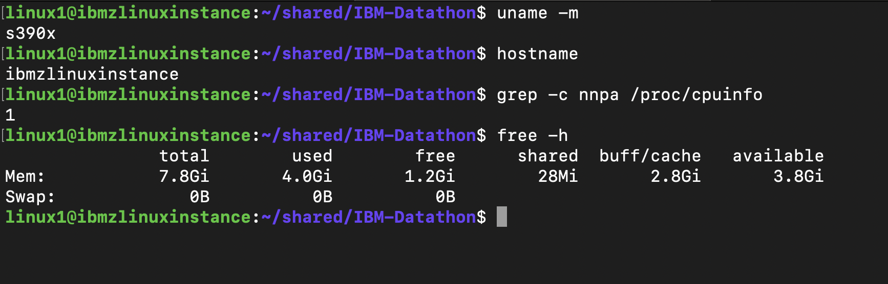
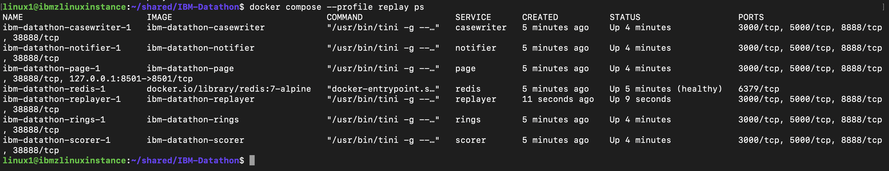
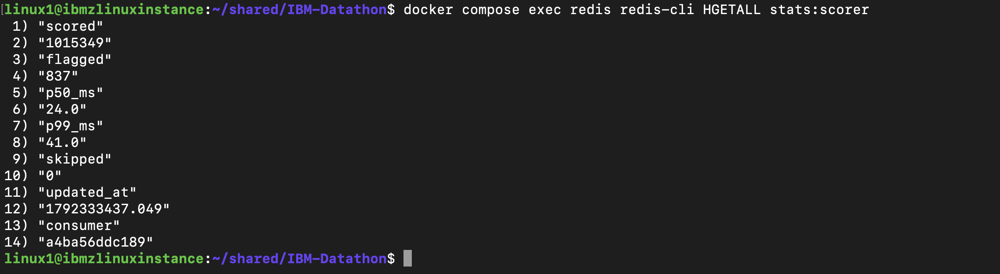
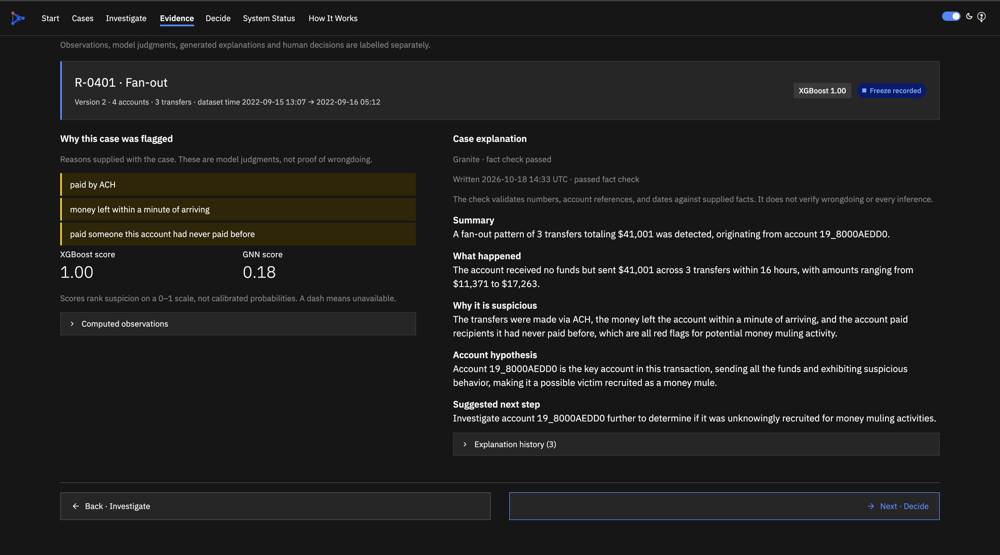
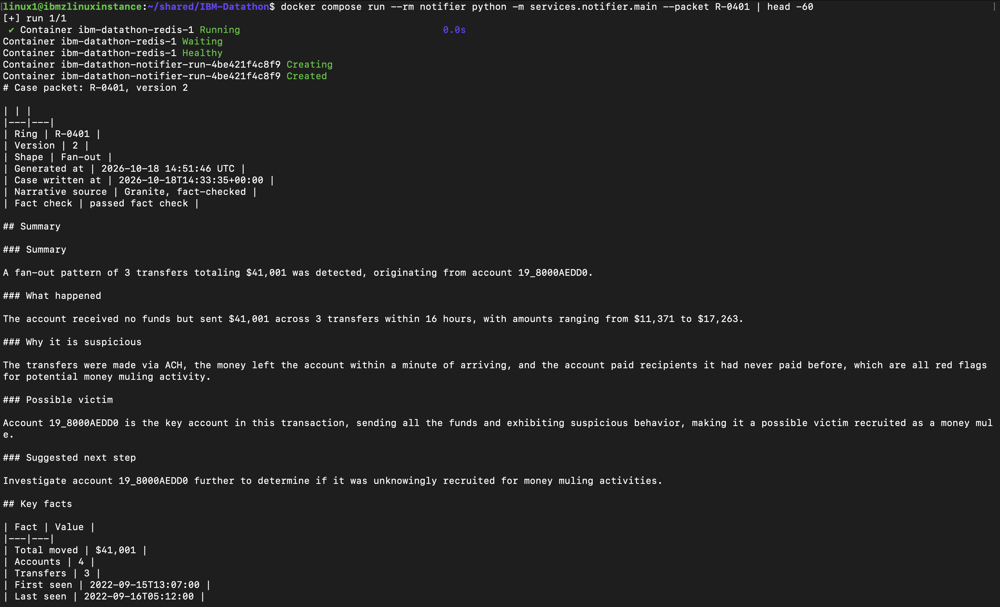
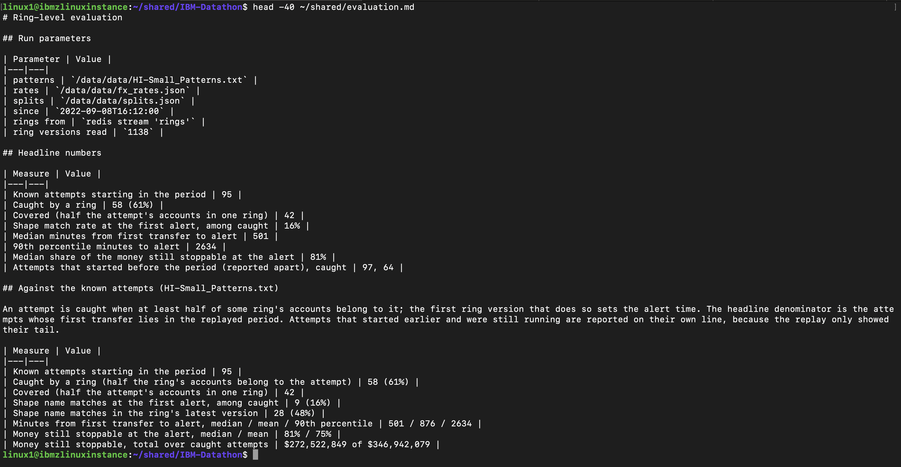

# DevMaxx_IBM Z Datathon 2026 Project

**Mule Ring Hunter** catches money-mule rings in real time, while the stolen money can still be stopped. Payments stream in, each one is scored in milliseconds, suspicious ones are grouped into rings within minutes, IBM Granite writes a fact-checked summary in seconds, and a person decides.

The AI recommends and explains. A person decides.



Everything here runs in seven containers on an IBM LinuxONE (s390x) virtual machine, on IBM's synthetic anti-money-laundering data. No real customer data is involved anywhere.

## Contents

- [Why this exists](#why-this-exists)
- [What it does in one minute](#what-it-does-in-one-minute)
- [Results](#results)
- [How it works](#how-it-works)
- [Screenshots and evidence](#screenshots-and-evidence)
- [Repository map](#repository-map)
- [Run it](#run-it)
- [From raw data to a trained model](#from-raw-data-to-a-trained-model)
- [Evaluation](#evaluation)
- [Configuration](#configuration)
- [Security](#security)
- [Honest limits and what is not built](#honest-limits-and-what-is-not-built)
- [Platform notes for LinuxONE](#platform-notes-for-linuxone)
- [Documentation index](#documentation-index)
- [Dataset](#dataset)
- [Libraries](#libraries)

## Why this exists

A money mule is a person who lets stolen money pass through their bank account, often without knowing what it is. Criminals recruit students and young job-seekers for it. In the first half of 2023 Cifas and UK Finance logged 17,286 cases bearing the hallmarks of money muling; 64 % involved people aged 30 or under and 23 % people aged 21 or under ([Cifas](https://www.cifas.org.uk/newsroom/money-mules-more-likely-to-be-aged-under-30)).

A single suspicious transfer is a hint. A group of accounts passing money between each other is a case. Banks today mostly find these rings days later, after the money has gone. This project finds the ring while it is forming, explains why in plain English, and puts the decision in front of a human investigator, treating the mule account as a possible victim rather than a criminal.

## What it does in one minute

| Step | What happens | Where |
|---|---|---|
| 1. Transfers stream in | The test period of the dataset is replayed one payment at a time, in time order, at 600x speed, onto a Redis stream | `services/replayer/` |
| 2. Measure the clues | For every payment, 32 behaviour clues are computed from the two accounts' past only: speed of pass-through, new payees, fan-in and fan-out counts, amounts versus the account's norm | `common/features.py` |
| 3. Score every payment | XGBoost turns the clues into a 0 to 1 suspicion score plus its top three reasons in words (from SHAP contributions), in about 24 ms end to end | `services/scorer/` |
| 4. Find the ring | Flagged transfers are connected into groups with union-find over a 24-hour window, hubs are excluded, the shape is named (fan-out, scatter-gather, cycle, ...), and a graph neural network gives each ring a second opinion | `services/rings/`, `common/gnn.py` |
| 5. Explain it in plain words | Code computes every number into a facts pack. Granite on watsonx.ai rewords it into a five-part case. A deterministic fact check rejects any reply with an invented number, account or date and falls back to a template | `services/casewriter/` |
| 6. A person decides | An investigator sees the ring, the reasons, both scores and the summary on a live page or a Slack card, and records Freeze, Dismiss or Needs more info to an append-only audit stream | `services/page/`, `services/notifier/` |

## Results

All numbers are from the real HI-Small data, measured on the LinuxONE VM. Reports with denominators and limitations live in `data/evaluation/`.

**The scorer (XGBoost, test split, 1,015,882 transfers, 1,798 laundering)**

| Measure | Value |
|---|---|
| Precision at the alert threshold | 0.85 |
| Recall at the alert threshold | 0.50 |
| F1 | 0.63 |
| PR-AUC | 0.64 |
| ROC-AUC | 0.99 |
| Transfers flagged / false alarms | 1,056 / 158 |
| Baseline "flag everything over $10,000", F1 | 0.009 |

IBM's own published XGBoost-with-graph-features result on this split is in the same range (F1 0.63 to 0.65). Every higher published score needed GPU hours; this one trained in under a minute on three CPU cores after the clue pass. Thresholds were chosen on the validation split only: alert 0.984 (best F1), ring 0.946 (precision at least 0.25, lower on purpose because rings need more edges).

**The rings, against the known laundering attempts (`HI-Small_Patterns.txt`, whole test period replayed)**

| Measure | Value |
|---|---|
| Known attempts starting in the period | 95 |
| Caught by a ring | 58 (61 %) |
| Median minutes from the attempt's first transfer to the alert | 501 |
| Median share of the money still stoppable at the alert | 81 % |
| Money still stoppable, total over caught attempts | $272.5 M of $346.9 M |
| Rings published / rings matching a known attempt | 393 / 153 |

Against the transfer labels in the same replay: 398 rings, 50 % of all test-period laundering transfers sit inside some ring, and the core transfers (at or above the ring threshold) are 61 % laundering against a base rate of 0.18 %. Fan-out, scatter-gather and gather-scatter rings are 89 to 93 % precise; fan-in is the weak shape (18 %, busy receivers rather than collectors).

**The live system on the VM (one scorer, speed 600)**

| Measure | Value |
|---|---|
| Scoring latency, p50 / p99 | 24 ms / 41 ms |
| Transfers scored in the replay | 1,015,349 |
| Scorer warm-up (4.06 M history rows) | about 3 minutes, about 2 GB |
| Replayer throughput, no pacing | about 29,000 msg/s (laptop measurement) |
| Granite fact-check pass rate on the hand-made rings | 3 of 3 |

The GNN is an honest second opinion, not the decider: on the same candidate transfers XGBoost reaches F1 0.67 and the GNN 0.39 (`models/gnn_meta.json`). Its score is shown next to XGBoost's on every card and page, and the ring service can hold back rings below a GNN threshold chosen with `scripts/evaluate_rings.py --gnn-sweep`.

## How it works

### Architecture

Seven containers, one image, Redis Streams between them. Every arrow is a stream; every consumer is in a consumer group, so a crashed service picks up its unacknowledged messages when it restarts.

```
 clean.csv ──► replayer ──txns──► scorer ──scored──► rings ──rings──► casewriter ──cases──► notifier ──► Slack / console
 (test period,   600x                 │ (XGBoost,            │ (24 h window,       │ (facts pack,          │  card with buttons
  no labels)                          │  32 clues,           │  union-find,        │  template, Granite,   │
                                      │  SHAP reasons)       │  shapes, GNN)       │  fact check)          ▼
                                      │                      │                     │                   decisions ◄──── investigator page
                                      └──────────────────────┴─────────────────────┴────────────────────────────────►  (reads scored, rings,
                                                                                             granite_requests ◄────────   cases, decisions)
```

| Stream | Written by | Read by | One message is |
|---|---|---|---|
| `txns` | replayer | scorer (group `scorers`) | one transfer: `txn_id, ts, from_acct, to_acct, amount_usd, amt_paid, ccy_paid, amt_recv, ccy_recv, fmt, sent_at`; never the label |
| `scored` | scorer | ring service, page | the transfer plus `score`, `flagged`, `reasons` (3 phrases), `clues`, `scored_at` |
| `rings` | ring service | case writer, page, notifier | `ring_id`, `version`, `shape`, `accounts`, `edges`, `xgb_score`, `gnn_score`, `reasons`, `first_seen`, `last_seen` |
| `cases` | case writer | page, notifier | the five-part summary, `source` (granite or template), `check_note`, `facts` |
| `granite_requests` | page | case writer | "write the Granite summary for this ring now" |
| `decisions` | page, notifier | page, notifier | `ring_id`, `version`, `decision` (freeze, dismiss, more_info), `note`, `decided_at`, `decided_by`, `channel` |

Stream names and the Redis host live in one place, `common/bus.py`; the `txns` message format in `common/streams.py`; the paths inside the containers in `common/paths.py`. Redis also holds a few hashes the page reads instead of counting messages: `stats:scorer` (counts and latency percentiles), `stats:rings`, `stats:casewriter`, and `case:<ring_id>` (the latest case for a ring, so a ring pushed out of the page's stream window still has its summary).

### Step by step

**Replayer.** Reads `clean.csv` from the test start in `splits.json` and sends one message per transfer, paced so that one data minute takes 0.1 s at speed 600. It never reads the label column. `--resume` continues after the last message already on the stream, so a restart sends no duplicates. The stream is capped at 1.1 million messages, the whole test period, so a scorer that falls behind delays messages instead of losing them.

**Scorer.** At start-up it feeds every row before the test start through the clue builder, so each of the 514,000 accounts has its history when the replay begins. Then it reads `txns` in batches of up to 200, computes the clues, scores with XGBoost using trees up to the early-stopping best iteration (exactly as the notebook did when choosing thresholds), and for every candidate at or above the ring threshold takes the three largest positive SHAP contributions and turns them into phrases such as "money left within a minute of arriving" (`services/scorer/reasons.py`). It refuses to start if `feature_list.json` does not match the clue list in code. `docker compose up -d --scale scorer=3` runs three consumers in the same group with no code change.

**Clues.** `common/features.py` is one class used in two places: the training notebook loops over the whole clean table with it, and the scorer calls it on every live message. The rule that makes this leak-proof: compute the clues for a transfer first, then add the transfer to the accounts' memory. The notebook's last cell pushes the first 1,000 transfers through the live path as text and compares with the offline table; the maximum difference is 0.0. Window sums are kept in integer cents because float residues once produced negative pass-through ratios.

**Ring service.** Keeps transfers with score at or above 0.5 for the last 24 data hours. Every 10 data minutes it runs union-find over the transfers at or above the ring threshold, leaves out hub accounts with more than 300 counterparties (so a bank cannot glue unrelated rings together), keeps groups of 3 to 50 accounts and splits larger ones with Louvain. Once a group exists, its members' weaker transfers (0.5 to the ring threshold) join it one hop out, highest score first: at the ring threshold the model finds 60 % of laundering transfers, at 0.5 it finds 86 %, so this is what turns a two-arrow fragment into the whole fan-out. A group sharing at least half its accounts with an existing ring keeps that `ring_id` and bumps the version. The shape is named most-specific-first: stack, bipartite, scatter-gather, gather-scatter, cycle, fan-out, fan-in, other. The clock is data time taken from the transfers, so the service behaves the same at any replay speed and in tests.

**GNN second opinion.** `common/gnn.py` is a small graph neural network in plain PyTorch: accounts are nodes, transfers are directed edges carrying the clues, the XGBoost score and the amount. Two message-passing layers gather incoming and outgoing transfers separately, then an edge classifier scores each transfer. It trains on the candidate subgraph of the validation split cut into 24-hour blocks, which is exactly what the ring service holds in its window, and learns from validation rather than train because XGBoost's scores on its own training rows are overconfident. Weights are a NumPy `.npz`, which records byte order, so a file written on a laptop loads on the big-endian LinuxONE machine. `services/gnn/` holds a teammate's earlier, separate GNN that the ring service does not use; its ring-level evaluation idea became `--gnn-sweep`.

**Case writer.** For every ring version it computes a facts pack: total moved, the key account (the one that passed the most money straight through, treated as a possible victim), the share passed on, hours until it began passing money on, origin and collector when they hold at least a quarter of the money, transfers just under the reporting threshold. A template summary is published within a second. Granite (`ibm/granite-4-h-small` on watsonx.ai over HTTPS) then rewrites the same facts into five parts: summary, what happened, why it is suspicious, possible victim, suggested next step. The fact check pulls every number, account ID and date out of the reply and compares them with the facts; one mismatch and the reply is discarded. By default (`GRANITE_MODE=on_demand`) Granite writes for the rings an investigator opens on the page, answered in one call's time on three parallel workers; `GRANITE_MODE=all` adds every other ring in the background. A 401 or 404 from watsonx disables Granite until restart and the template carries on, so a missing credential never blocks the demo.

**Investigator page.** One frame with one page per step, in IBM Carbon styling: Start, Cases (a ranked queue), Investigate (the money-flow graph with inferred origin and final recipient, play-through of the transfers in dataset order), Evidence (reasons, both scores, computed observations and the explanation with its source and fact-check note), Decide (Freeze, Needs more info, Dismiss with a note, plus the case packet download), System Status and How It Works. Streamlit on a laptop; on the VM, where Streamlit cannot install, the same logic modules serve a Flask page on the same port automatically. Decisions record an audit instruction; they do not perform a bank freeze.

**Reviewer bot.** Posts each case to Slack (Socket Mode, an outbound websocket, no inbound port) or prints it to the console, with the three buttons. A click writes the same `decisions` message the page writes, plus who decided and through which channel, so a decision in Slack shows as a badge on the page. Dismissed rings stay quiet for 24 hours unless they grow materially (two more accounts or 50 % more money). The bot also renders the case packet, a Markdown report with every transfer's `txn_id` traceable to `clean.csv`, the input file's SHA-256 and the decision log.

## Screenshots and evidence

All taken on the LinuxONE VM during the final replay, following `docs/demo-runbook.md`.

| | |
|---|---|
|  | **Platform.** `uname -m` prints `s390x`; the Telum accelerator is visible to the VM (`nnpa` present); 8 GB of memory. |
|  | **Containers.** All seven up, Redis healthy. The PORTS column is empty for everything except the page, bound to `127.0.0.1:8501` only. |
|  | **Latency.** `stats:scorer` after the whole test period: 1,015,349 scored, p50 24 ms, p99 41 ms. |
|  | **Evidence.** The three reasons from XGBoost, both model scores, and Granite's explanation labelled "fact check passed" with the time it was written. |
|  | **Case packet** for R-0401 rendered from the notifier: header, the five summary parts, key facts. |
|  | **Evaluation** against the known attempts: 58 of 95 caught, median 501 minutes to alert, 81 % of the money still stoppable. |

More in `screenshots/`: the first messages flowing through scorer, rings and case writer (`03-flow`), the decisions stream after a Freeze from the page (`10-decisions`), the security evidence (`11-security`), the training run in Jupyter on the VM (`13-training-*`), and the two LinuxONE platform labs as run on the VM (`labs/`, not part of the solution).

## Repository map

```
common/                 shared code every service imports
  features.py             the 32 (+7 newer) past-only clues, one class for training and live scoring
  gnn.py                  the GNN second opinion (plain PyTorch, .npz weights)
  streams.py, bus.py      the txns message format; Redis host and stream names
  clean_transactions.py   the cleaning pipeline; fx.py, splits.py, quality.py, data_contract.py support it
  paths.py                /data/data and /data/models inside the containers
services/
  replayer/               step 1: clean.csv -> txns
  scorer/                 steps 2 and 3: txns -> scored (reasons.py holds the phrase table)
  rings/                  step 4: scored -> rings (window, union-find, hubs, Louvain, shapes, GNN hook)
  gnn/                    a teammate's earlier stand-alone GNN; kept for reference, not wired in
  casewriter/             step 5: rings -> cases (facts, template, Granite, fact check)
  page/                   step 6: the investigator page (Streamlit app.py, Flask flask_app.py, shared logic modules)
  notifier/               step 7: cases -> Slack or console cards -> decisions; the case packet
scripts/
  clean_data.py           HI-Small_Trans.csv -> clean.csv, splits.json, fx_rates.json, data_quality.md
  validate_clean.py       independent checker of the cleaning outputs (shares no code with it)
  train_xgboost.py        the notebook as a script: seeds, tuning, precision@K, model comparison
  train_gnn.py            trains the GNN on the candidate subgraph, reports it next to XGBoost
  evaluate_rings.py       ring-level evaluation against the patterns file and the labels; --gnn-sweep; --markdown
  stress_replayer.py      one reproducible messages-per-second number for the replayer
  train_taint.py          offline experiment (rejected): feeding earlier scores back as clues
  probe_datetime.py       which pandas timestamp forms survive on s390x
notebooks/
  train_xgboost.ipynb     the training notebook (load, clues, train, thresholds, test, sanity checks)
  train_xgboost_vm_run.ipynb  the same notebook as run on the VM, with outputs: the run that produced models/
models/                   scorer.json, feature_list.json, thresholds.json, gnn.npz, gnn_meta.json
data/evaluation/          evaluation.md and evaluation-labels.md (+ JSON) from the VM replay
tests/                    cross-service tests: pipeline end to end, ordering, leakage, splits, FX
docs/                     plans, runbook, hand-off notes, the team guide PDF (see the index below)
screenshots/              the evidence above
Dockerfile, docker-compose.yml, .env.example, requirements*.txt
```

Each service folder has its own README with its inputs, outputs, message fields, options and laptop commands.

## Run it

### The whole stack on the LinuxONE VM

Needs Docker with Compose, `~/shared/data/clean.csv` and `splits.json` (from the cleaning below), `~/shared/models/` (this repo's `models/`, or your own training run) and, for the evaluation, `~/shared/data/HI-Small_Patterns.txt`. The compose file mounts `~/shared` as `/data` in every container. From the repo root on the VM:

```bash
docker compose up -d --build                      # Redis, scorer, rings, case writer, notifier, page
docker compose logs -f scorer                     # wait for "scoring 'txns' -> 'scored'": the warm-up takes a few minutes
docker compose --profile replay up -d replayer    # only then start the replay of the test period
ssh -L 8501:localhost:8501 linux1@<vm-ip>         # from your laptop, then open http://localhost:8501
```

The replayer sits behind the `replay` profile on purpose: started before the scorer's warm-up finishes, the stream fills while the scorer is still loading history and the demo shows a backlog instead of live scoring. Useful variations:

```bash
docker compose --profile replay ps                # all seven containers
docker compose up -d --scale scorer=3             # three scorers on one queue (add one at a time on 8 GB)
docker compose exec redis redis-cli HGETALL stats:scorer
docker compose exec redis redis-cli XRANGE decisions - +
docker compose --profile replay run --rm replayer python -m services.replayer.main --start 2022-09-09T06:00:00
docker compose run --rm notifier python -m services.notifier.main --packet R-0001
docker compose --profile replay down
```

The VM has 8 GB and one scorer holds about 2 GB after warm-up; check `free -h` before anything big. `docs/demo-runbook.md` walks through resilience (kill a scorer replica and watch its pending messages drain), scale-out, replayer resume, the stream cap, decisions audit, security and evaluation, with the expected output of every command.

### Tests, training and evaluation inside the image

Everything also runs inside the compose image on the VM, which has PyTorch, XGBoost, pytest and fakeredis:

```bash
docker compose run --rm --no-deps scorer python -m pytest -q
docker compose run --rm --no-deps scorer python -m scripts.train_gnn --data /data/data --models /data/models
docker compose run --rm scorer python -m scripts.evaluate_rings --patterns /data/data/HI-Small_Patterns.txt \
    --rates /data/data/fx_rates.json --splits /data/data/splits.json --redis --markdown /data/evaluation.md
```

### Pieces on a laptop

Python 3.12 is the safe choice. Each piece runs without the others.

```bash
python3 -m venv .venv && .venv/bin/pip install -r requirements.txt -r requirements-dev.txt

# the test suite (about 430 tests; fakeredis stands in for Redis)
.venv/bin/python -m pytest -q

# the case writer on three hand-made rings, no Redis or Granite needed
.venv/bin/python -m services.casewriter.main --file services/casewriter/fake_rings.json

# the reviewer bot as text, decisions typed on stdin (needs a local Redis and the case writer)
REDIS_HOST=localhost .venv/bin/python -m services.notifier.main --console

# the investigator page alone, on a private in-process Redis with three fixture cases
.venv/bin/pip install -r requirements-page.txt
.venv/bin/python -m services.page.fake.run          # then open http://127.0.0.1:8501

# the replayer and scorer against a local Redis (docker run -d -p 6379:6379 redis:7-alpine)
REDIS_HOST=localhost .venv/bin/python -m services.replayer.main --clean data/processed/clean.csv --splits data/processed/splits.json --limit 20000 --speed 0
REDIS_HOST=localhost .venv/bin/python -m services.scorer.main --models models --clean data/processed/clean.csv --splits data/processed/splits.json --once
```

On a Mac, PyTorch and XGBoost in one process can deadlock (two OpenMP runtimes). Run the suite as two processes: everything except `tests/test_gnn.py` and `services/gnn`, then those two with `KMP_DUPLICATE_LIB_OK=TRUE`. Train the GNN on the VM, not on a Mac.

## From raw data to a trained model

### Cleaning

`scripts/clean_data.py` turns `HI-Small_Trans.csv` into one typed, time-sorted table and a few reports. It never edits the raw file and never auto-fixes data: if something breaks the data contract (`common/data_contract.py`), the run stops with exit code 1 and says why in `data_quality.md`.

```bash
.venv/bin/pip install -r requirements-cleaning.txt
.venv/bin/python -m scripts.clean_data --input HI-Small_Trans.csv --out data/processed          # about a minute, 5 GB of memory
.venv/bin/python -m scripts.clean_data --input HI-Small_Trans.csv --out data/processed/sample --sample-every 50   # quick, not final
.venv/bin/python -m scripts.validate_clean --out data/processed --input HI-Small_Trans.csv      # independent check
```

Outputs in the `--out` folder (git-ignored):

| File | What it is |
|---|---|
| `clean.csv` | every transaction with `txn_id`, `<bank>_<account>` IDs, native amounts, `amount_usd`, label, `self_transfer` flag and `split`. Read it back with `common.clean_transactions.read_clean_csv`, which restores the column types (no parquet: the LinuxONE image has no pyarrow) |
| `splits.json` | the two time cut-offs, the split rules and per-split counts |
| `fx_rates.json` | exchange rates (USD per unit) learned from the training rows only; the team's one rate table, used by the scorer and the case writer alike |
| `data_quality.md`, `validation.md` | measured checks, runtime, memory, limitations; the independent checker's report |

The split is by time only, never by labels: validation starts at the timestamp at 60 % of the sorted rows, test at 80 %. On HI-Small that is 5,078,345 transfers (5,177 laundering, 0.10 %); train 3,046,861 rows, validation 1,015,602 (from 2022-09-06 13:36), test 1,015,882 (from 2022-09-08 16:12).

### Training the scorer

`notebooks/train_xgboost.ipynb` runs in the LinuxONE Jupyter container in six sections: load the clean table and split, compute the clues for all five million rows through `ClueBuilder` (about five minutes), train XGBoost with `scale_pos_weight` and early stopping on validation PR-AUC (250 trees, best iteration 149, under a minute), pick the two thresholds on validation, evaluate on test once next to the $10,000 baseline, then the sanity checks: clue averages for laundering versus normal rows and the live-versus-offline leakage test. `notebooks/train_xgboost_vm_run.ipynb` is the run that produced the committed `models/`, with its outputs. `scripts/train_xgboost.py` is the same training from the command line with seeds, tuning, precision@K and a comparison against an existing model.

`models/scorer.json` is portable XGBoost JSON. `feature_list.json` fixes the clue order and the scorer refuses to start if it disagrees with the code. The newer 39-clue feature list keeps the first 32 in place, and the scorer and GNN select clues by name, so the committed 32-clue model keeps running.

### Training the GNN

```bash
python -m scripts.train_gnn --data /data/data --models /data/models      # a few minutes on 3 cores
```

Reads `features.csv` and `clean.csv`, scores every transfer with the committed XGBoost model, keeps the candidate subgraph (score at or above 0.5), trains with early stopping on held-out PR-AUC, and prints test precision, recall, F1 and PR-AUC for XGBoost, the GNN and their average on the same transfers. Writes `gnn.npz` and `gnn_meta.json`; the ring service loads them when present.

## Evaluation

`scripts/evaluate_rings.py` answers three questions about a replay: how many known laundering attempts did the rings catch, how fast, and how much of the money was still stoppable at that moment. An attempt is caught when at least half of some ring's accounts belong to it; the first ring version that does so sets the alert time. Only attempts whose first transfer falls in the replayed period count in the headline; attempts that started earlier are reported on their own line.

```bash
# against the known attempts (needs HI-Small_Patterns.txt); --markdown writes the report
python -m scripts.evaluate_rings --patterns ... --rates ... --splits ... --redis --out eval.json --markdown evaluation.md
# against the transfer labels: ring precision, coverage, precision by shape
python -m scripts.evaluate_rings --labels clean.csv --models models --redis
# what the GNN adds: the same numbers with no GNN and at each GNN threshold
python -m scripts.evaluate_rings --labels ... --models ... --patterns ... --splits ... --redis --gnn-sweep
```

The committed reports are `data/evaluation/evaluation.md` (attempt level) and `evaluation-labels.md` (label level), both from the VM replay of the whole test period with one scorer and the committed model. Their limitations are written down: the patterns file names 3,209 of the 5,177 laundering transfers, so a ring matching no attempt is not shown to be a false alarm; times are data time, not wall clock; the alert time is the regroup that published the ring.

## Configuration

Copy `.env.example` to `.env` at the repo root. `.env` is git-ignored and compose passes it to the case writer and the notifier; everything works without it on the template and the console adapter.

| Variable | Default | Meaning |
|---|---|---|
| `WATSONX_APIKEY`, `WATSONX_URL` | blank, `https://us-south.ml.cloud.ibm.com` | watsonx.ai credentials; blank runs on the template only |
| `WATSONX_PROJECT_ID` or `WATSONX_SPACE_ID` | blank | where Granite calls are billed; the space wins when both are set (see `services/casewriter/README.md`, step 6) |
| `GRANITE_MODEL_ID` | `ibm/granite-4-h-small` | the Granite model; names change, check the project |
| `GRANITE_MODE`, `GRANITE_WORKERS` | `on_demand`, `3` | which rings Granite writes for, and on how many threads |
| `GRANITE_LOCAL` | `0` | `1` runs the image's small Granite through llama.cpp instead (about 90 s per ring, demo only) |
| `SPEED` | `600` | replayer speed-up, data seconds per real second |
| `NTHREAD` | `1` | XGBoost threads per scorer |
| `GNN_THRESHOLD` | blank | hold back rings the GNN scores below this; blank publishes every ring with its score |
| `NOTIFIER_ADAPTER` | `console` | `console` or `slack` |
| `SLACK_BOT_TOKEN`, `SLACK_APP_TOKEN`, `SLACK_CHANNEL` | blank | Slack app in Socket Mode; setup steps in `services/notifier/README.md` |
| `DASHBOARD_URL` | `http://localhost:8501` | link on every card |
| `SUPPRESS_HOURS` | `24` | how long a dismissed ring stays quiet |
| `REDIS_HOST`, `REDIS_PORT` | `redis`, `6379` | inside compose the default is right; on a laptop use `localhost` |

## Security

- No secrets in the repo: `.gitignore` covers `.env`, `data/`, the raw Kaggle files and caches; the only committed example is `.env.example` with blank values.
- Redis publishes no port; it is reachable only inside the compose network. The page binds to `127.0.0.1:8501` on the VM and is reached through an SSH tunnel. Slack uses Socket Mode, so no inbound port is opened for it.
- Every container runs as the image's non-root user (`ibm-user`, uid 1000).
- The scorer never sees labels: the replayer drops the label column before sending, and `message_to_txn` rejects a message with an unexpected field.
- Granite never sees raw data and never decides anything. It receives a facts pack computed by code and its reply is checked number by number.
- Decisions are an append-only audit stream with who, what, where and when. They record an instruction; nothing in this project moves or freezes real money.

## Honest limits and what is not built

- **The GNN is a second opinion, not an improvement on XGBoost.** Measured on the same candidate transfers, XGBoost F1 0.67, GNN 0.39. Both scores are shown; XGBoost decides.
- **Fan-in rings are noisy** (18 % precision against the labels): half of them are busy receivers rather than collectors. A stricter fan-in rule is the obvious next step.
- **Shape names at the first alert match the patterns file 16 % of the time**, 48 % in the ring's latest version. The shape is a label for the investigator, not what catches the ring.
- **Telum is present but not used.** The VM reports the `nnpa` accelerator and the Dockerfile tries to install Snap ML, but no Snap ML or Telum scoring code exists and no acceleration is claimed. The latency numbers are CPU.
- **Microsoft Teams delivery was planned and not built.** The notifier has console and Slack adapters; `--adapter teams` falls back to the console with a message.
- **Three scorers split the account history.** Each replica sees a third of the transfers, so its clues drift from the offline ones. One scorer gives the accuracy numbers, three give the throughput screenshot.
- **The answer key is incomplete.** `HI-Small_Patterns.txt` names 3,209 of 5,177 laundering transfers, so a ring matching no attempt is not necessarily a false alarm.
- **Synthetic data.** HI-Small comes from IBM's simulator. Nothing here has been tried on real transactions, and the page's labels say so.

## Platform notes for LinuxONE

Things discovered on the s390x VM that the code and the Dockerfile now handle:

- The base image is the LinuxONE Jupyter image, which ships PyTorch, XGBoost, scikit-learn, pandas, networkx and graphviz built for s390x. The Dockerfile freezes those versions as pip constraints: an optional package once pulled pandas down to a from-source build that segfaulted in every datetime operation. Optional packages (Streamlit, `ibm-watsonx-ai`, Snap ML) are each tried on their own and skipped if they will not install; the case writer calls watsonx over plain HTTPS, so losing the SDK costs nothing.
- Streamlit needs pyarrow, which has no s390x build, so the page command tries Streamlit and falls back to the Flask page on the same port.
- `redis:7` has no s390x image; `redis:7-alpine` does.
- pandas on s390x segfaults when `to_datetime` has to guess the format; every path passes an explicit format (`scripts/probe_datetime.py` tests the forms).
- LinuxONE is big-endian. The XGBoost model is JSON and the GNN weights are a NumPy `.npz`, so files trained on a laptop load correctly.
- One image for every service; the Dockerfile copies `common/`, `services/`, `scripts/` and `tests/`, so training, evaluation and the full suite run inside it.

## Documentation index

| Document | What it holds |
|---|---|
| `docs/session-summary.md` | the full hand-off: state, numbers, per-feature file pointers, gotchas, what is left |
| `docs/demo-runbook.md` | every evidence command on the VM with expected output, screenshot name and judging point |
| `docs/next-steps.md` | pipeline status, VM commands, the facts everyone needs (cut-offs, paths, memory) |
| `docs/research-model-training.md` | the research report behind the model choices and the published baselines |
| `docs/model-improvement-plan.md`, `docs/stretch-goals-plan.md` | ranked model work and the stretch goals, with their status |
| `docs/investigator-page-plan.md`, `docs/page-improvements.md`, `docs/ui-redesign-handoff.md` | the page's design, known limits and the redesign's verification record |
| `docs/casewriter-integration-plan.md` | how the case writer meets the ring service and the page |
| `docs/Mule_Ring_Hunter_Laptop_Cleaning_Plan.md` | the cleaning pipeline's plan |
| `docs/teamguide.pdf` | the team's helper guide: the six-step pipeline, hand-offs between steps, links |
| `services/<name>/README.md` | each service's contract, options and laptop commands |

## Dataset

[IBM Transactions for Anti Money Laundering (AML)](https://www.kaggle.com/datasets/ealtman2019/ibm-transactions-for-anti-money-laundering-aml), the **HI-Small** version: 18 days of synthetic bank transfers in September 2022, about 5 million transfers between 515,000 accounts, 5,177 of them laundering. Two files are used: `HI-Small_Trans.csv` (every transfer with its label) and `HI-Small_Patterns.txt` (the known laundering attempts with their shape names, used for evaluation only, never as a model input). The data is generated by IBM's simulator ([Altman et al., NeurIPS 2023](https://arxiv.org/abs/2306.16424)); there are no real customers in it.

## Libraries

Models and data: [XGBoost](https://xgboost.readthedocs.io), [PyTorch](https://pytorch.org), [scikit-learn](https://scikit-learn.org), [pandas](https://pandas.pydata.org), [NumPy](https://numpy.org), [NetworkX](https://networkx.org), [matplotlib](https://matplotlib.org) (notebook plots).
Streaming and services: [Redis](https://redis.io) (Streams, consumer groups) and [redis-py](https://github.com/redis/redis-py), [Flask](https://flask.palletsprojects.com), [Streamlit](https://streamlit.io), [requests](https://requests.readthedocs.io), [slack-bolt](https://github.com/slackapi/bolt-python) and [slack-sdk](https://github.com/slackapi/python-slack-sdk).
Explanations: [IBM Granite](https://www.ibm.com/granite) on [watsonx.ai](https://www.ibm.com/products/watsonx-ai) over HTTPS; [llama-cpp-python](https://github.com/abetlen/llama-cpp-python) for the optional local Granite.
Pictures and styling: [Graphviz](https://graphviz.org) and [viz.js](https://github.com/mdaines/viz-js) for the Flask page's ring picture, [IBM Carbon](https://carbondesignsystem.com) design language with [IBM Plex](https://www.ibm.com/plexsans).
Platform: [Docker Compose](https://docs.docker.com/compose/) on the [IBM LinuxONE Community Cloud](https://linuxone.cloud.marist.edu), the LinuxONE Jupyter image as the base.
Tests: [pytest](https://docs.pytest.org), [fakeredis](https://github.com/cunla/fakeredis-py).
